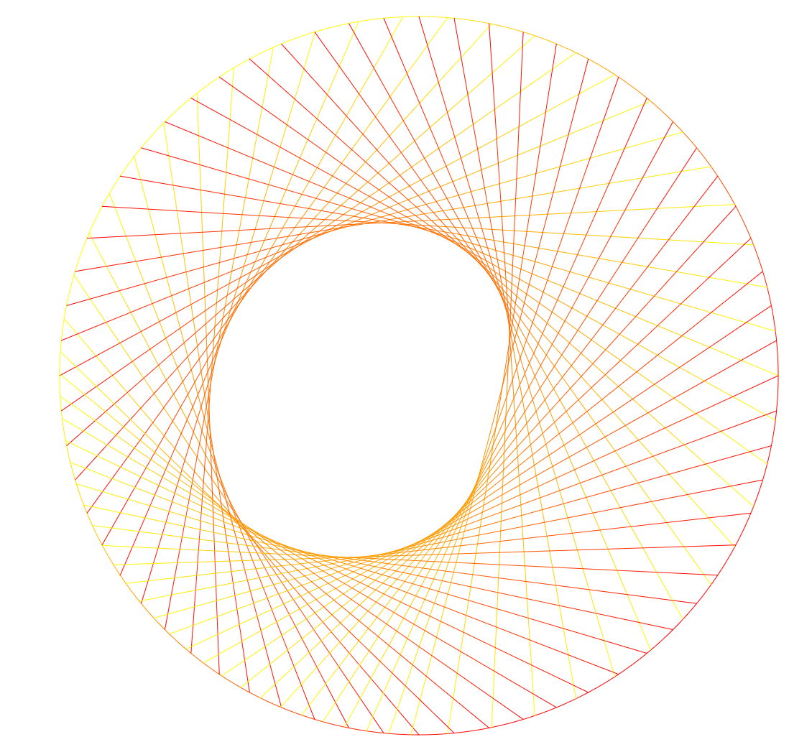
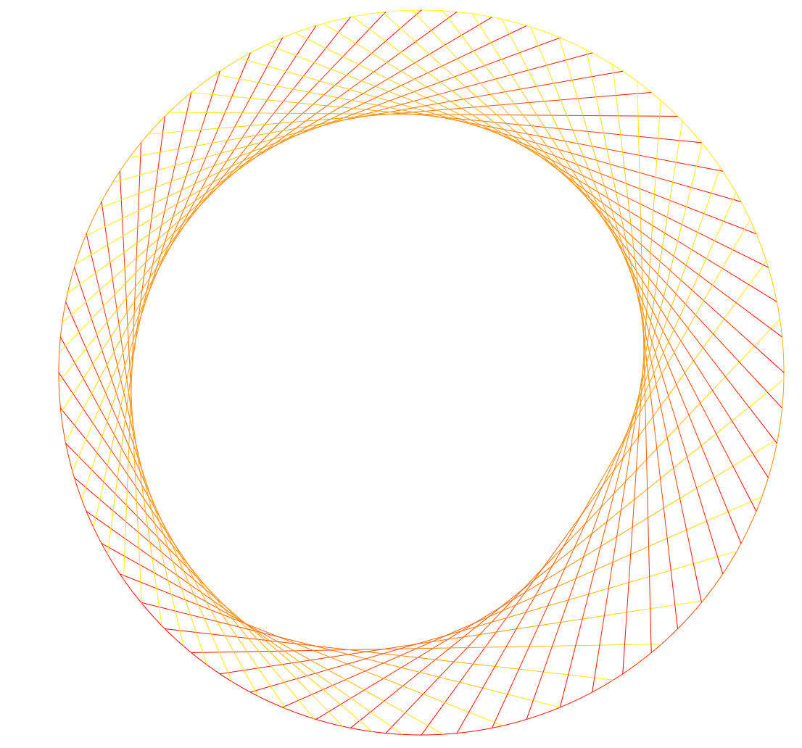
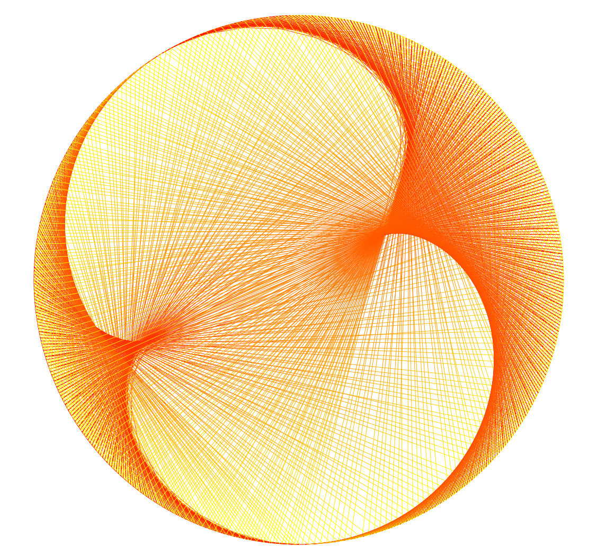
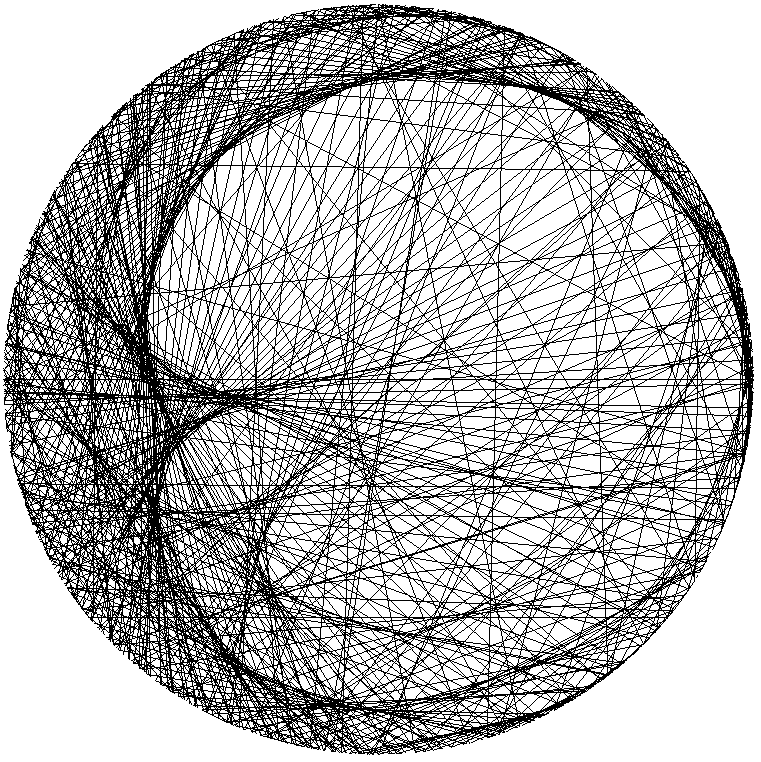

# Arithmetic Envelopes on the Circle

Code, notebooks and data for **[Arithmetic Envelopes on the Circle: An Introduction](doc/Pedal_Curves.pdf)** and for the related article on *Diophantine imaging* ([Scientific Reports, 2024](https://doi.org/10.1038/s41598-023-49960-y)).

<p align="center">
  
  
  
  
</p>

Place numbers on a circle and join each label $x$ to the label of $g(x)$. The curve that every chord touches is an *arithmetic envelope*. For $x \mapsto kx \bmod 1$ it is an epicycloid: the cardioid for $k=2$, the nephroid for $k=3$. Labelling the odd integers by their binary digits identifies them with the Prüfer 2-group. In these coordinates, multiplication by 3 is conjugate to the rotation by $\log_2 3$. The main result of the paper (Theorem 1, *Henkel's convexoid*) shows that the chords $x \to 3x$ leave free a convex region, bounded by the segment $[-\tfrac17, \tfrac15]$ and two epicycloid arcs. The heart-shaped pedal curve of the same chord family lies on the algebraic curves $x = \rho\,T_5(\rho)$ and $x = \rho\,T_7(\rho)$.

## Repository layout

| Folder | Content |
| --- | --- |
| [`doc/`](doc) | The paper (PDF) |
| [`python/programs/`](python/programs) | Standalone scripts that reproduce results of the paper |
| [`python/notebooks/`](python/notebooks) | Jupyter notebooks for drawing dreamcatchers and envelopes |
| [`mathematica/`](mathematica) | Wolfram notebooks: derivations, implicitizations, plots |
| [`mathematica/datasets/`](mathematica/datasets) | Solutions of $x^3+y^3+z^3=n$ and of $a^3+b^3+c^3=d^3$ (see its README) |
| [`matlab/`](matlab) | Symbolic elimination of parametrizations |
| [`img/`](img) | Images used in this README |

## Artifacts by section of the paper

| § | Topic | Artifacts |
| --- | --- | --- |
| 2–3 | Chord families, envelopes, caustics of $\times2$, $\times3$, $\times k$ | [`caustics_simple.ipynb`](python/notebooks/caustics_simple.ipynb), [`caustics.ipynb`](python/notebooks/caustics.ipynb) |
| 4 | Dyadic labelling and the Prüfer 2-group | [`prüfer_group_operator.nb`](mathematica/pr%C3%BCfer_group_operator.nb), [`circle_numbers.nb`](mathematica/circle_numbers.nb), [`pruefer_group_p2p3.nb`](mathematica/pruefer_group_p2p3.nb), [`caustics_base2_3.ipynb`](python/notebooks/caustics_base2_3.ipynb) |
| 5 | **Henkel's convexoid** (Theorem 1) | [`python/programs/convexoid/`](python/programs/convexoid) (see below) |
| 6 | Heart-shaped pedal curve and its polynomials | [`heartshape_red_blue.nb`](mathematica/heartshape_red_blue.nb), [`heartshape_red_blue_polynomial.nb`](mathematica/heartshape_red_blue_polynomial.nb) |
| 7 | Implicit equations of epicycloids; the map $x \mapsto x^3$ | [`cycloid_implicitization.nb`](mathematica/cycloid_implicitization.nb), [`getCartesians.m`](matlab/getCartesians.m), `dupin_*.nb` |
| A | Tropicalization | [`drawtrop.py`](python/programs/tropical/drawtrop.py) (from the course MCS 595, 2013) |
| B | Piecewise linear labelling reproducing the cardioid | [`cardioid.nb`](mathematica/cardioid.nb), [`pedal_parametric_curves.nb`](mathematica/pedal_parametric_curves.nb), [`pedal_parametric_simplified_a.nb`](mathematica/pedal_parametric_simplified_a.nb), [`pedal_curves_interactive.nb`](mathematica/pedal_curves_interactive.nb), `pedal_*.nb`, `deriv_*.nb` |

The notebooks `dupin_*.nb` keep the working name "Dupin-like" from an earlier draft; they treat the non-linear map $x \mapsto x^3$ and the maps $x \mapsto ax$.

## Reproducing Theorem 1

```bash
cd python/programs/convexoid
pip install numpy scipy sympy matplotlib
python fig_convexoid.py          # figure of the convexoid and of the logarithmic labelling
python heart_vs_convexoid.py     # corner C, areas, implicit equations, convexoid vs. heart
python convexoid_proof_check.py  # computer-assisted step of the proof (resultants)
```

Expected values: $t_r \approx 1.8291729217$, $t_b \approx 2.4646905931$, $C \approx 0.21545 + 0.42511i$, area $\approx 0.19210$. The proof check reports exactly one intersection of the two arcs and no self-intersection of the second arc.

## Diophantine imaging

The notebooks `three_cubes*.nb` and `cubic_quadruples_base_*.nb` (bases $2, 3, 7, e, \varphi, \pi$) produce the figures of the [Scientific Reports article](https://doi.org/10.1038/s41598-023-49960-y). The data sources and download scripts are described in [`mathematica/datasets/README.md`](mathematica/datasets/README.md) and [`download_prepare_esp.ipynb`](python/notebooks/download_prepare_esp.ipynb).

## Further experiments

These are exploratory and not part of the paper: [`irrational_rotations.nb`](mathematica/irrational_rotations.nb), [`poincare_collatz.nb`](mathematica/poincare_collatz.nb), [`poincare_collatz_discrete.nb`](mathematica/poincare_collatz_discrete.nb), [`rotate_left_plot.nb`](mathematica/rotate_left_plot.nb), [`ternary_plot.nb`](mathematica/ternary_plot.nb), [`negative_pedal_curves.ipynb`](python/notebooks/negative_pedal_curves.ipynb) and [`caustics_vis.ipynb`](python/notebooks/caustics_vis.ipynb), which draws base-$n$/base-$m$ envelopes in 3D. The prime dreamcatcher in `caustics.ipynb` joins the $i$-th to the $i^2$-th prime and reads the pickled prime list [`primes_179424673.bin`](python/notebooks/primes_179424673.bin).

## Requirements

- Python 3 with `numpy`, `scipy`, `sympy` and `matplotlib`; Jupyter for the notebooks.
- Wolfram Mathematica for the `.nb` files.
- MATLAB with the Symbolic Math Toolbox for `getCartesians.m`.

## Related work

- E. Sultanow, M. Henkel, I. J. Aberkane: *Diophantine imaging reveals the broken symmetry of sums of integer cubes.* Scientific Reports 14, 16 (2024). [doi:10.1038/s41598-023-49960-y](https://doi.org/10.1038/s41598-023-49960-y)
- A. Rahn, E. Sultanow, M. Henkel, S. Ghosh, I. J. Aberkane: *An algorithm for linearizing the Collatz convergence.* Mathematics 9(16), 1898 (2021). [doi:10.3390/math9161898](https://doi.org/10.3390/math9161898)
- M. Henkel: *Visualizing the Collatz Feather as an L-System.* Master's thesis, University of Applied Sciences Schmalkalden (2021). [Code](https://github.com/Sultanow/collatz/tree/master/06%20Collatz%20L-System)
